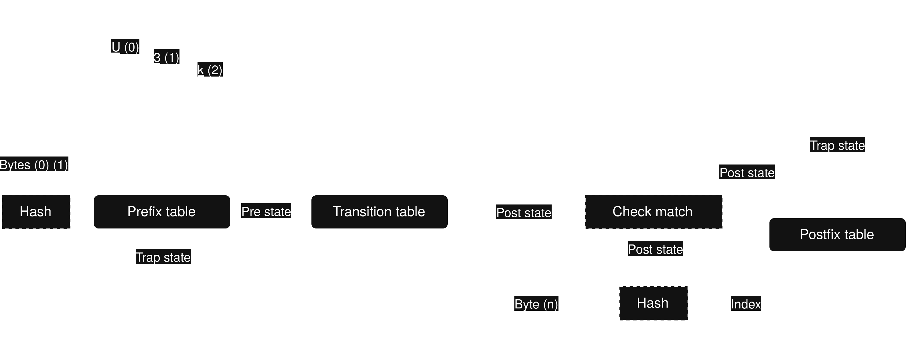
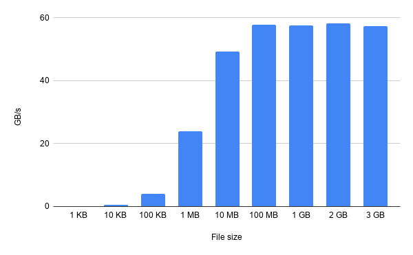

# Report

README has info about the tool and building the project!

The project idea was to scan for virus signatures in files. The project was
suppose to be about the gpu gem chapter 35:

- [Fast Virus Signature Matching on the GPU](https://developer.nvidia.com/gpugems/gpugems3/part-v-physics-simulation/chapter-35-fast-virus-signature-matching-gpu)

But their approach felt a little incomplete. If a thread got `[i .. j]` bytes
from the input, the next would get `[j .. k]` etc. Each thread would hash the
two first bytes and index into `[65536][4]u8` array. Then it would compare the
rest of the input bytes with the `[4]u8` it got from the array.

The biggest issue with this approach was the static size of the signatures, it
meant that the CPU had to check the GPU's work and this wouldn't do. I wasn't
able to come up with a solution myself, so I did some reading and found this
paper:

- [The Aho-Corasick Paradigm in Modern Antivirus Engines: A Cornerstone of Signature-Based Malware Detection](https://jyu.finna.fi/PrimoRecord/pci.cdi_gale_infotracacademiconefile_A870211977?sid=5294192376)

It mentions Parallel Failure-less Aho-Corasick (PFAC), which seemed to be
flexible and "easy" to implement. Unfortunately I wasn't able to access the
orginal paper for PFAC :( But I found this:

- [Article 2: Two-Phase PFAC Algorithm for Multiple Patterns Matching on CUDA GPUs](https://jyu.finna.fi/PrimoRecord/pci.cdi_crossref_primary_10_3390_electronics8030270?sid=5294863437)

It expands on the orginal paper a bit, but it also gives an idea on how the
orginal PFAC worked. It's basically Aho-Corasick string matching algorithm, but
we strip away the fallback/failure states. With them removed the finite state
machine (FSM) is started on each byte of the input by seperate threads. If the
FSM by a thread fails at n, then a thread n would have started at that point,
thus PFAC behaves like Aho-Corasick with the added benefit of being pararell.

This is an overview of how my implementation works:


The added transition table works well if most of the prefix table isn't full, as
prefix integer type is smaller than the transition or postfix table's. One thing
that needs fixing, is making the size of the transition table not fixed!

## Did challenges appeared in this project? What?

Looking back, not really, it was pretty smooth sailing expect few nasty bugs,
but ones I added some test, they got fixed.

## Did you learn anything specific in working through this project? What?

Well of course I learned about PFAC, but I also learned how Aho-Corasick string
matching algorithm worked. A lot about testing, first time using fixed buffered
writers to test stdout output, didn't even know that was possible. And! More
about zig's build system! It's so good!

## Example result on a completely random file:

### GPU:

```
$ zig build -Dmetrics=true run -- signatures.json ~/Downloads/TestFiles/GB1.txt --capacity 100 --warm-up --output c
FSM BUILD TIME: 4.22375 ms
GPU TIME: 15.94408 ms
GPU PERF: 67.34425 GB/s
0
```

Which is pretty good, I'm happy with the results. Note this is only with 255
signatures with no matches, so this is the ideal situation.

It was generated like this:

```
head -c 1GB /dev/urandom > ~/Downloads/TestFiles/file.txt
```

### CPU

```
$ zig build -Dmetrics=true run -- signatures.json ~/Downloads/TestFiles/GB1.txt
--capacity 100 --cpu --output c FSM BUILD TIME: 4.17075 ms CPU TIME: 2390.86293
ms CPU PERF: 0.44910 GB/s 0
```

NOT GOOD!! the CPU implementation mimics how the GPU implementation works so
it's very slow.

## Performance



These were the avarage of 5 runs and they where run with options:

```
zig build -Dmetrics=true run -- signatures.json ~/TestFolder/Files/size.txt --capacity 100 --output c --warm-up
```

The `--warm-up` launches a dummy kernel which stops cold starts from effecting
our performance.

The files where generated with:

```
head -c size /dev/urandom > size.txt
```

- (1 KB - 100 KB). Fixed GPU kernel launch and memory transfer costs dwarf the
  actual computation at these sizes.

- (100 KB – 10MB) throughput climbs sharply from 4 GB/s to 49 GB/s as the input
grows large enough to keep GPU threads occupied.

- (10 MB - 3 GB) Throughput plateaus at ~58 GB/s, this is a memory-bound
  ceiling. Only way to get better performance, would be to reduce PFAC FSM size.

Next for the project I would experiment with other ways to implement PFAC:

- [Accelerating Pattern Matching Using a Novel Multi-Pattern-Matching Algorithm on GPU](https://jyu.finna.fi/PrimoRecord/pci.cdi_gale_infotracacademiconefile_A758856754?sid=5294192376)
- [PFAC Library: GPU-Based String Matching Algorithm](https://developer.download.nvidia.com/GTC/PDF/GTC2012/PresentationPDF/S0054-GTC2012-PFAC-GPU-Algorithm.pdf)
